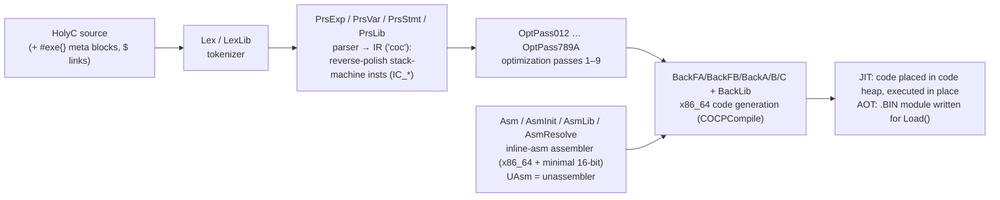

# 08 — Compiler and Toolchain

The HolyC compiler is a first-class component of TempleOS: it ships as an AOT binary, is
loaded by `KMain()` before anything else runs, and from then on compiles *everything* —
user programs, scripts, songs, automations — just-in-time. There is **no linker and no
object files** anywhere in the system (`Doc/Strategy.DD`, `Doc/Glossary.DD`).

## Compiler pipeline (`Compiler/`)

- The driver is `CmpJoin()` in [`Compiler/CMain.HC`](../Compiler/CMain.HC): it sets up a
  compilation context (hash tables chained to the task's symbol table), then per statement
  runs parse → optimize (`COCPCompile`) → emit. In AOT mode emitted code is stored via
  `AOTStoreCodeU64` into the module image; map files (`.MAP`, e.g. [`Kernel/Kernel.MAP`](../Kernel/Kernel.MAP))
  can be written out for symbol inspection.
- The IR is a **reverse-polish stack machine** ("coc" code objects); it can be inspected
  with `PassTrace()`, and final assembly viewed via `Trace()` or unassembly (`U`/`Uf`).
  The compiler never *interprets* user code — JIT means "compile to memory now", not
  bytecode execution.
- The assembler handles inline `asm{}` blocks, including **minimal 16-bit support** used
  only for the boot loaders (`Doc/Strategy.DD`, `Demo/Lectures/Ring3.HC` etc.).

## JIT vs AOT modes (`Doc/Glossary.DD`)

| | JIT (default) | AOT |
|---|---|---|
| Trigger | `#include "file"`, `ExeFile()`, command line, `JobQue(JOBT_EXE_STR)` | `Cmp()` on a `.PRJ` file list |
| Output | Code + data placed incrementally in the code heap, executed in place | A single `.BIN` module (no `.OBJ` step) later loaded with `Load()` |
| Used for | Everything at runtime: apps, scripts, songs, automations | Exactly two artifacts: **the kernel module** and **the compiler itself** (+ pure-asm boot sectors) |
| Unloading | Only by killing the task (no unload mechanism) | n/a — loaded once at boot |

## Build flow for the OS image

1. **`BootHDIns()`** (`Adam/Opt/Boot/BootHDIns.HC`) calls `MakeAll()`, which AOT-compiles:
   - [`Kernel/Kernel.PRJ`](../Kernel/Kernel.PRJ) → the kernel module binary
     (checked in as C-encoded form under `/0000Boot/`), and
   - [`Compiler/Compiler.PRJ`](../Compiler/Compiler.PRJ) → `/Compiler/Compiler.BIN`.
2. `.PRJ` files are **HolyC source lists**, not makefiles: they `#include` the module's
   `.HC` files in dependency order, interleaved with `#exe{}` blocks that configure the
   compiler mid-build (options like `OPTf_KEEP_PRIVATE`, `OPTf_EXTERNS_TO_IMPORTS`) and —
   for the kernel — instantiate a `CKCfg` compile-time configuration object (`KCfg.HC`:
   mount letters, disk-cache size expression, `CFG_NO_MP`, debug-distro options…).
3. The boot sector is then **patched with the LBA** of the new kernel binary (boot sectors
   can't read directories — see [03](03-boot-process.md)).
4. At runtime there is no build step at all: `KMain()` does `Load("Compiler")`, and
   `StartOS.HC` JIT-compiles `/Adam/MakeAdam` and `~/MakeHome` into the Adam task.

## Consequences for new work (e.g., a network stack)

- New subsystems are just more `.HC` files: add them to a `.PRJ` list if they must be in
  the kernel module, or leave them JIT-loadable from source like everything else. **No
  build system changes are needed** — there is no makefile to update.
- Because AOT modules resolve symbols through the runtime hash-table chain (not a linker),
  cross-module references use `extern`/`import` declarations as in
  [`Kernel/KExts.HC`](../Kernel/KExts.HC).
- The compiler's own source is fair game for modification, but it is one of only two AOT
  artifacts — changes to it require a full kernel rebuild + boot-sector re-patch cycle.
